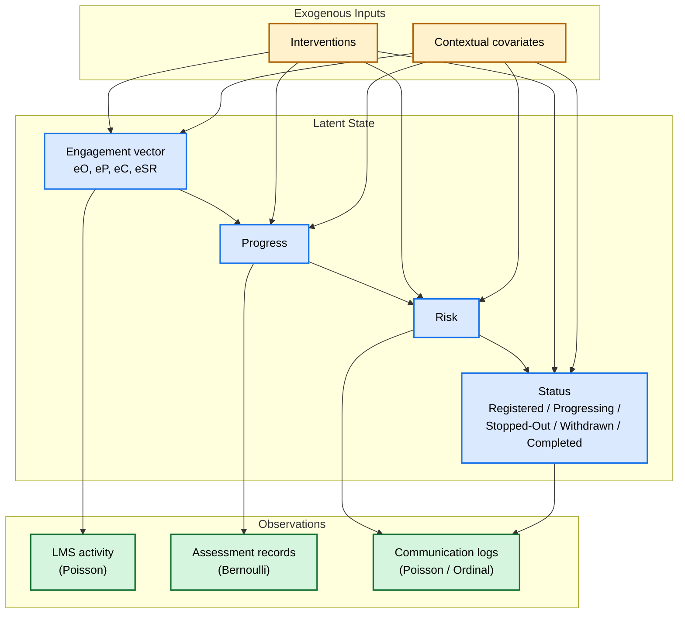

# README.md for `dlsm-lib`

# DLSM: Dynamic Latent-State Model of Student Engagement

[](https://pypi.org/project/dlsm/)
[](https://www.python.org/downloads/)
[](https://opensource.org/licenses/MIT)
[](https://github.com/hongxueharriswang/dlsm-lib/actions)
[](https://github.com/astral-sh/ruff)
[](https://doi.org/10.5281/zenodo.0000000)

**A Python library for modelling student engagement in self-paced learning as a latent, dynamic, multi-dimensional state.**

> **Repository:** [https://github.com/hongxueharriswang/dlsm-lib](https://github.com/hongxueharriswang/dlsm-lib)

---

## Table of Contents

- [Overview](#overview)
- [The DLSM Model](#the-dlsm-model)
- [Features](#features)
- [Installation](#installation)
- [Quick Start](#quick-start)
- [Repository Structure](#repository-structure)
- [Core Components](#core-components)
- [API Reference](#api-reference)
- [Examples](#examples)
- [Reproducibility](#reproducibility)
- [Running Tests](#running-tests)
- [Citation](#citation)
- [License](#license)
- [Contributing](#contributing)
- [Acknowledgments](#acknowledgments)

---

## Overview

Student engagement in self-paced online learning is conventionally measured through static, retrospective indicators such as LMS activity counts, quiz scores, and submission records. These approaches treat engagement as an observable outcome rather than an evolving latent process, and they perform poorly in self-paced contexts where learning activity is irregular, sparse, and partially offline.

**DLSM** addresses this problem by representing engagement as a **continuous, multi-dimensional latent state** that evolves over time according to stochastic differential equations and is observed through a heterogeneous measurement model. The model is formalized as a **hybrid continuous–discrete state-space system** and estimated using **Bayesian inference via particle filtering**.

This library implements the model described in:

> Wang, H. et al. (2026). *A Dynamic Latent-State Model of Student Engagement in Self-Paced Learning.* (Manuscript under review.)

**Target audience:** learning analytics researchers, educational data scientists, and developers building engagement-aware learning systems.

---

## The DLSM Model

The DLSM represents each student's latent state at time \(t\) as:

\[
\mathbf{X}_t = \big( S_t,\; \mathbf{E}_t,\; P_t,\; R_t \big)^\top
\]

where:

| Component | Symbol | Space | Description |
|-----------|--------|-------|-------------|
| **Status** | \(S_t\) | \(\{1,\dots,5\}\) | Registered, Progressing, Stopped-Out, Withdrawn, Completed |
| **Engagement** | \(\mathbf{E}_t\) | \([0,1]^4\) | \((e^O, e^P, e^C, e^{SR})\) — Observing, Participating, Contributing, Self-Regulated |
| **Progress** | \(P_t\) | \([0,1]\) | Academic progress |
| **Risk** | \(R_t\) | \([0,1]\) | Latent propensity for adverse outcomes |

The engagement vector evolves according to coupled stochastic dynamics with the hierarchical constraint \(e^O \geq e^P \geq e^C\). The discrete status transitions follow a multinomial logistic model that depends on the continuous state. Observations are generated through Poisson, Bernoulli, and ordered-probit channels.



**Figure 1.** Graphical representation of the DLSM. Latent states (top) evolve over time according to coupled stochastic dynamics. The engagement vector drives progress, which drives risk, which influences discrete status transitions. Observations (bottom) are generated through heterogeneous measurement channels.

---

## Features

- **Continuous-time formulation** — SDEs with Euler–Maruyama discretization
- **Particle filtering** — Bootstrap particle filter with systematic resampling for online state tracking
- **PMCMC estimation** — Particle Marginal Metropolis–Hastings for parameter estimation
- **Hybrid state space** — Combines continuous latent variables with discrete status transitions
- **Ordered-cone constraint** — Enforces \(e^O \geq e^P \geq e^C\) via PAVA projection
- **Heterogeneous observations** — Poisson, Bernoulli, and ordered-probit channels
- **Missing data handling** — Naturally skips update when observations are missing
- **Reproducible** — All stochastic components accept explicit `np.random.Generator` seeds
- **Visualization** — Built-in plotting for trajectories, posteriors, and calibration

---

## Installation

### From PyPI (recommended)

```bash
pip install dlsm
```

### From source (development version)

```bash
git clone https://github.com/hongxueharriswang/dlsm-lib.git
cd dlsm-lib
pip install -e .
```

### With optional dependencies

```bash
pip install "dlsm[viz]"        # matplotlib for visualizations
pip install "dlsm[progress]"   # tqdm for progress bars
pip install "dlsm[all]"        # everything
```

### Requirements

- Python ≥ 3.9
- `numpy` ≥ 1.23
- `scipy` ≥ 1.9

Optional: `matplotlib` ≥ 3.6 (visualization), `tqdm` ≥ 4.64 (progress bars)

---

## Quick Start

```python
import numpy as np
from dlsm import DLSM, DLSParams, ParticleFilter, Simulator, plots

# 1. Define parameters
params = DLSParams.default()

# 2. Create model
model = DLSM(params)

# 3. Simulate a cohort
sim = Simulator(model, seed=42)
data = sim.simulate(n_students=20, n_timesteps=60, event_prob=0.3)

# 4. Run particle filter on the first student
pf = ParticleFilter(model, n_particles=1000, seed=0)
result = pf.filter(
    data.observations[0],
    events=data.events[0],
)

# 5. Inspect results
print(f"Log-likelihood: {result.log_likelihood:.2f}")
print(f"Mean ESS:       {result.ess.mean():.1f}")
print(f"State shape:    {result.mean_states.shape}")   # (T, 6)

# 6. Visualize
fig = plots.plot_latent_trajectories(
    true_states=data.states[0],
    filtered_mean=result.mean_states,
    filtered_std=np.sqrt(result.var_states),
)
fig.savefig("trajectories.png", dpi=150)
```

### Parameter recovery with PMCMC

```python
from dlsm import PMCMC
from dlsm.evaluation import metrics

# Estimate parameters from a synthetic trajectory
pmcmc = PMCMC(
    model,
    n_particles=500,
    n_iterations=2000,
    burn_in=500,
    thin=5,
    proposal_scale=0.02,
    seed=0,
)
result = pmcmc.fit(data.observations[0], events=data.events[0])

# Inspect recovery
table = metrics.parameter_recovery_table(
    params.as_vector(),
    result.chain,
    result.param_names,
)
for row in table:
    print(f"{row['parameter']:10s}  true={row['true']:+.3f}  "
          f"post={row['posterior_mean']:+.3f}  covered={row['covered']}")
```

---

## Repository Structure

```
dlsm-lib/
├── pyproject.toml
├── README.md
├── LICENSE
├── requirements.txt
├── requirements-dev.txt
├── requirements-lock.txt
├── dlsm/
│   ├── __init__.py
│   ├── _numerics.py              # shared numerical primitives
│   ├── core/
│   │   ├── __init__.py
│   │   ├── parameters.py         # DLSParams
│   │   ├── state.py              # Status, DLSMState
│   │   ├── dynamics.py           # drift, step, status transitions
│   │   ├── observations.py       # ObservationModel, Observation
│   │   └── constraints.py        # ordered-cone projection (PAVA)
│   ├── inference/
│   │   ├── __init__.py
│   │   ├── particle_filter.py    # ParticleFilter, FilterResult
│   │   ├── pmcmc.py              # PMCMC, PMCMCResult
│   │   └── diagnostics.py        # gelman_rubin, effective_sample_size
│   ├── simulation/
│   │   ├── __init__.py
│   │   └── simulator.py          # Simulator, SimulatedData
│   ├── evaluation/
│   │   ├── __init__.py
│   │   └── metrics.py            # rmse, coverage, auc, brier_score
│   ├── models/
│   │   ├── __init__.py
│   │   └── dlsm.py               # DLSM (main orchestrator)
│   └── viz/
│       ├── __init__.py
│       └── plots.py              # trajectory, posterior, calibration plots
├── tests/
│   ├── __init__.py
│   ├── test_core.py              # core module tests
│   ├── test_inference.py         # filtering and PMCMC tests
│   └── test_simulation.py        # simulator tests
└── examples/
    ├── simulate_and_filter.py
    ├── parameter_recovery.py
    └── empirical_validation.py
```

---

## Core Components

| Component | Module | Description |
|-----------|--------|-------------|
| `DLSParams` | `dlsm.core.parameters` | Model parameters (α, λ, β, ω, γ, Q, R, w) |
| `DLSMState` | `dlsm.core.state` | Single state sample (status + continuous vector) |
| `Status` | `dlsm.core.state` | Enum for discrete program statuses |
| `DLSM` | `dlsm.models.dlsm` | Main model orchestrator |
| `ParticleFilter` | `dlsm.inference.particle_filter` | Bootstrap particle filter |
| `FilterResult` | `dlsm.inference.particle_filter` | Output of filtering pass |
| `PMCMC` | `dlsm.inference.pmcmc` | Particle Marginal Metropolis–Hastings |
| `PMCMCResult` | `dlsm.inference.pmcmc` | Output of PMCMC run |
| `Simulator` | `dlsm.simulation.simulator` | Synthetic data generation |
| `SimulatedData` | `dlsm.simulation.simulator` | Container for synthetic datasets |
| `metrics` | `dlsm.evaluation.metrics` | RMSE, coverage, AUC, Brier score |
| `plots` | `dlsm.viz.plots` | Visualization helpers |
| `gelman_rubin` | `dlsm.inference.diagnostics` | MCMC convergence diagnostic |
| `effective_sample_size` | `dlsm.inference.diagnostics` | MCMC efficiency diagnostic |

---

## API Reference

### `DLSParams`

```python
from dlsm import DLSParams

params = DLSParams.default()                    # sensible defaults
params = DLSParams(alpha_O=0.4, gamma=0.3)      # custom
v = params.as_vector()                          # flatten to 1-D
params2 = DLSParams.from_vector(v, template=params)
```

Key attributes:

- `alpha_O, alpha_P, alpha_C, alpha_SR` — engagement growth rates
- `lambda_O, lambda_P, lambda_C, lambda_SR` — engagement decay rates
- `beta_0, beta_1, beta_2, beta_3` — progress dynamics
- `gamma, omega_0, omega_1, omega_2, omega_3` — risk dynamics
- `q_diag` — process noise variances (length 6)
- `w_count, w_binary, w_ordinal` — observation weight matrices
- `w_status` — status transition coefficients, shape (5, 5, 6)
- `dt` — discretization step

### `ParticleFilter`

```python
from dlsm import DLSM, DLSParams, ParticleFilter

model = DLSM(DLSParams.default())
pf = ParticleFilter(model, n_particles=1000, seed=0)
result = pf.filter(observations, events=events)

result.mean_states        # (T, 6)
result.var_states         # (T, 6)
result.status_probs       # (T, 5)
result.log_likelihood     # float
result.ess                # (T,)
```

### `PMCMC`

```python
from dlsm import PMCMC

pmcmc = PMCMC(
    model,
    n_particles=2000,
    n_iterations=10000,
    burn_in=2000,
    thin=10,
    proposal_scale=0.02,
    seed=0,
)
result = pmcmc.fit(observations, events=events)

result.chain              # (n_keep, 17)
result.posterior_mean()   # (17,)
result.credible_interval(0.95)  # (2, 17)
```

### `Simulator`

```python
from dlsm import Simulator

sim = Simulator(model, seed=42)
data = sim.simulate(n_students=50, n_timesteps=60, event_prob=0.3)

data.states           # (50, 60, 6)
data.statuses         # (50, 60)
data.observations     # [50][60] list of Observation
data.events           # (50, 60, 4)
```

### `plots`

```python
from dlsm.viz import plots

plots.plot_latent_trajectories(true_states, filtered_mean, filtered_std)
plots.plot_status_probabilities(status_probs, true_status)
plots.plot_posterior(chain, param_names, true_params)
plots.plot_calibration(predicted_prob, outcomes)
```

---

## Examples

Complete runnable examples are in the `examples/` directory:

| Example | Description |
|---------|-------------|
| [`simulate_and_filter.py`](examples/simulate_and_filter.py) | Simulate a cohort and run the particle filter |
| [`parameter_recovery.py`](examples/parameter_recovery.py) | PMCMC parameter recovery on synthetic data |
| [`empirical_validation.py`](examples/empirical_validation.py) | Template for AU data validation |

Run any example with:

```bash
python examples/simulate_and_filter.py
```

---

## Reproducibility

The library is designed for reproducible research. All stochastic components accept explicit seeds:

```python
sim = Simulator(model, seed=42)
pf = ParticleFilter(model, n_particles=1000, seed=0)
pmcmc = PMCMC(model, seed=0, ...)
```

### Reproducing the paper's simulation study

A fully pinned environment is provided in `requirements-lock.txt`:

```bash
pip install -r requirements-lock.txt
python examples/parameter_recovery.py
```

The simulation study protocol (100 replications per condition, master seed 20240101, convergence diagnostics) is described in Section 5 of the manuscript.

### Software environment

| Component | Version |
|-----------|---------|
| Python | 3.11.6 |
| NumPy | 1.26.2 |
| SciPy | 1.11.4 |
| Matplotlib | 3.8.2 |
| tqdm | 4.66.1 |

---

## Running Tests

```bash
# Install development dependencies
pip install -r requirements-dev.txt

# Run the full test suite
pytest tests/ -v

# Run with coverage
pytest tests/ --cov=dlsm --cov-report=html

# Run only core tests
pytest tests/test_core.py -v
```

Expected: all tests pass in under 10 seconds.

---

## Citation

If you use this library in your research, please cite:

```bibtex
@article{wang2026dlsm,
  title   = {A Dynamic Latent-State Model of Student Engagement in Self-Paced Learning},
  author  = {Wang, Hongxue and others},
  journal = {Manuscript under review},
  year    = {2026},
  note    = {Software available at https://github.com/hongxueharriswang/dlsm-lib}
}
```

To cite the software itself:

```bibtex
@software{dlsm_lib,
  title  = {DLSM: A Python Library for Dynamic Latent-State Modeling of Student Engagement},
  author = {Wang, Hongxue},
  year   = {2026},
  url    = {https://github.com/hongxueharriswang/dlsm-lib},
  doi    = {10.5281/zenodo.0000000}
}
```

---

## License

This project is licensed under the **MIT License** — see the [LICENSE](LICENSE) file for details.

```
MIT License

Copyright (c) 2026 Hongxue Wang

Permission is hereby granted, free of charge, to any person obtaining a copy
of this software and associated documentation files (the "Software"), to deal
in the Software without restriction, including without limitation the rights
to use, copy, modify, merge, publish, distribute, sublicense, and/or sell
copies of the Software, and to permit persons to whom the Software is
furnished to do so, subject to the following conditions:

The above copyright notice and this permission notice shall be included in all
copies or substantial portions of the Software.

THE SOFTWARE IS PROVIDED "AS IS", WITHOUT WARRANTY OF ANY KIND, EXPRESS OR
IMPLIED, INCLUDING BUT NOT LIMITED TO THE WARRANTIES OF MERCHANTABILITY,
FITNESS FOR A PARTICULAR PURPOSE AND NONINFRINGEMENT.
```

---

## Contributing

Contributions are welcome! Please follow these guidelines:

1. **Fork** the repository and create a feature branch (`git checkout -b feature/my-feature`).
2. **Install** development dependencies: `pip install -r requirements-dev.txt`
3. **Write tests** for any new functionality.
4. **Run the test suite**: `pytest tests/ -v`
5. **Format** your code with `black` and `ruff`:
   ```bash
   black dlsm/ tests/
   ruff check dlsm/ tests/
   ```
6. **Submit a pull request** with a clear description of the changes.

### Development setup

```bash
git clone https://github.com/hongxueharriswang/dlsm-lib.git
cd dlsm-lib
python -m venv .venv
source .venv/bin/activate       # Linux/macOS
# .venv\Scripts\activate        # Windows
pip install -e ".[dev]"
pre-commit install
```

### Reporting issues

Please use the [GitHub issue tracker](https://github.com/hongxueharriswang/dlsm-lib/issues) to report bugs or request features.

---

## Acknowledgments

This work was conducted in the context of research on learning analytics and self-paced learning at Athabasca University. The author thanks colleagues and reviewers for their constructive feedback on the DLSM framework.

### Related work

- **`pomp`** (R) — Partially observed Markov processes via particle filtering and PMCMC
- **`pyParticleFilter`** — Lightweight particle filtering utilities
- **`statsmodels`** — State-space models and Kalman filtering
- **`pyMC`** — Bayesian inference with MCMC and variational methods

The DLSM library differs from these by providing a domain-specific implementation of a hybrid continuous–discrete state-space model tailored to student engagement, with built-in support for the ordered-cone constraint, heterogeneous observation channels, and status-transition dynamics specific to self-paced learning contexts.

---

## External Links

- **Repository:** [https://github.com/hongxueharriswang/dlsm-lib](https://github.com/hongxueharriswang/dlsm-lib)
- **Issue Tracker:** [https://github.com/hongxueharriswang/dlsm-lib/issues](https://github.com/hongxueharriswang/dlsm-lib/issues)
- **Documentation:** [https://dlsm-lib.readthedocs.io](https://dlsm-lib.readthedocs.io) *(coming soon)*
- **PyPI:** [https://pypi.org/project/dlsm](https://pypi.org/project/dlsm)

---

**Last updated:** 2026-10-02
